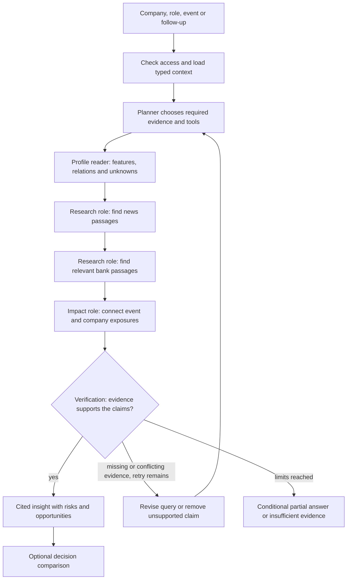
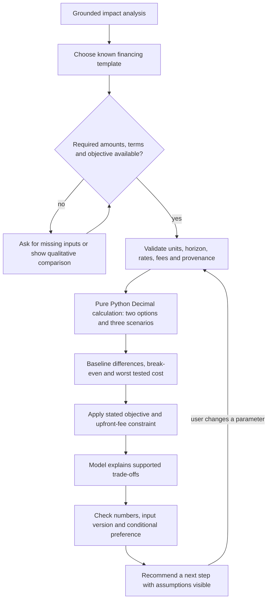

# Agent logic and explanatory diagrams

The prototype will use an original Python state machine. Specialized roles are functions and prompts sharing typed state; there is no LangGraph, LangChain orchestration or prebuilt agent team. Keep this document, the architecture, and the in-product agent diagram aligned as implementation progresses.

**Current status:** the UI mockup illustrates this logic. Its stage animation and retry branch are simulated; the only actual analytical execution there is the deterministic financing calculator in JavaScript. No real agent or model is running yet.

## From request to grounded insight

The planner proposes structured actions. The Python dispatcher checks scope, schemas, allowed tool names and budgets before execution. News and bank text are untrusted evidence, never instructions. Each successful or failed action updates the shared run record so the next step can use previous results.

The research steps may execute only the searches the task needs. The diagram is an explanation, not a requirement to call every tool in a fixed sequence. A follow-up can reuse valid evidence; a changed company must start with that company's scope.

## Shared state and role responsibilities

| Role | Reads | Produces |
|---|---|---|
| Planner | Authorized company/role, event/question, prior steps, remaining budget | Needed facts, planned tool actions, missing-data questions |
| Profile reader | Versioned profile and permitted one-hop relations | Observed/derived/unknown features with provenance |
| Research | Event topics, company exposures, search results and dates | Relevant news and bank passage IDs, gaps and conflicts |
| Impact analyst | Company features and retrieved passages | Source facts, bank views, conditional AI implications, risks and opportunities |
| Verifier | Draft claims, source passages, features and prior checks | Supported claims, required corrections, revised retrieval needs or abstention |
| Decision analyst | Verified insight, explicit user inputs, objective and calculation results | Trade-offs and next steps referencing assumptions and figures |

The state holds `company_id`, user/role scope, question/event IDs, profile and evidence versions, plan, step results, claims, unknowns, checks, remaining call/token/cost/time budgets, and optional versioned scenario inputs/results. Persist safe action summaries and source/result references, not hidden chain-of-thought or credentials.

## From impact to decision

The model chooses relevant tools and explains consequences. It does not invent rates, fabricate bank quotes, execute financial actions or replace the arithmetic. For the mockup, a labeled template supplies the explanation; the final implementation must call an approved model and check its result against the calculator output.

## Self-check and stopping rules

Start with six tool executions and two draft/check cycles per run, plus a configurable time/token/cost limit. A failed call consumes the applicable budget. An invalid action never executes. If essential evidence is missing after permitted retries, remove the unsupported claim or return an explicit limitation. Do not label the result complete simply because the state machine stopped.

Example: a credit-product flag exists, but rate terms are unknown. The verifier requests a targeted search for repricing terms. If none are available, the insight remains conditional; a quantitative comparison requests explicit inputs. The UI mockup's retry button illustrates this branch without performing that search.

## Mapping to implementation

| Mockup location | Future implementation responsibility |
|---|---|
| `data.js` synthetic companies and sources | `ingest.py`, `context.py`, database and provenance records |
| `ranked()` and `impactText()` in `app.js` | `ranking.py`, retrieved evidence and approved-model interpretation |
| `agentDiagram()` | Human-readable diagram of `agent.py` transitions and stopping rules |
| `agentBody()` and `refresh()` | Real persisted tool steps and run status, rather than animation-generated completion |
| `calculate()` | `scenarios.py` with Decimal, schema checks and independently verified formulas |
| `ask()` | Scoped question continuation through the actual agent, rather than template selection |

When implementing or changing a transition, update the corresponding diagram and expose the evidence behind it in the trace. Keep passed checks, retries, partial answers, fixture runs and real model runs visibly distinct.
