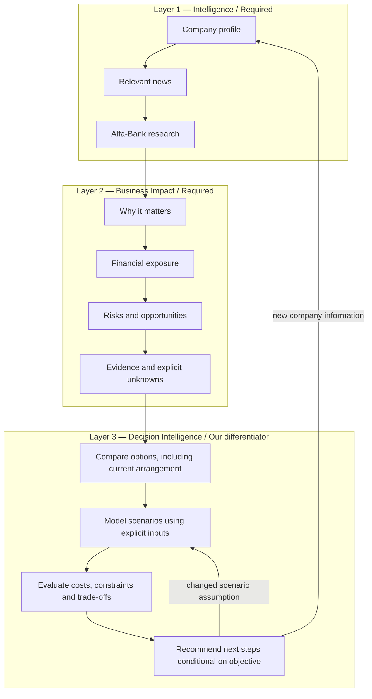
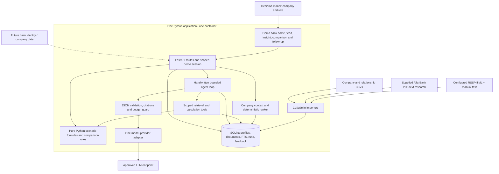
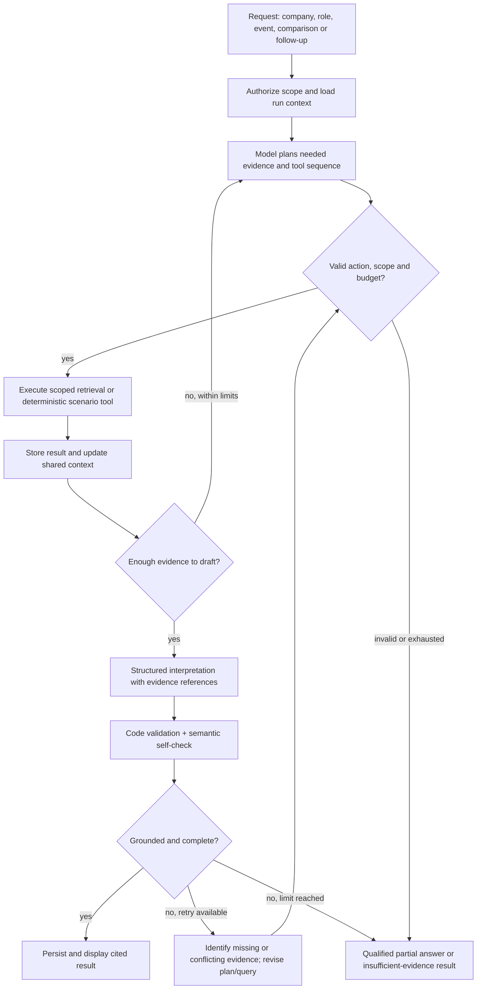
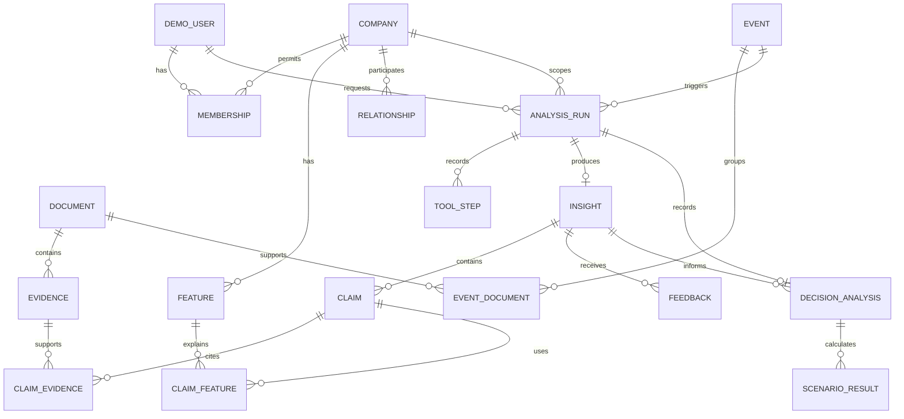

# Architecture, pipeline, and workflows

## 1. Architecture in plain language

One Python web app reads company data, ingests news and bank research, ranks events for a selected person/company, and asks an approved model to analyze a selected event. It then offers a small decision comparison using explicit inputs and deterministic scenario calculations. SQLite stores the inputs, evidence, scenario versions, user feedback, and analysis runs. A small handwritten agent chooses read-only retrieval/calculation tools, checks the result, and revises it when evidence is incomplete.

The browser presents facts, the bank's sourced view, AI implications, and calculated scenario outputs separately. Opening a citation reveals the original passage; opening a calculated figure reveals its inputs, formula and assumptions. Opening the activity trace reveals tool actions and validation results, not hidden model reasoning. The model cannot execute code, browse freely, change payment data, or act on bank products.

The three product layers describe the journey through the same application, not three separately deployed services:



Everything below is a proposed design. Dashed connections in the component diagram are future integrations; the bank shell and user login are explicitly simulated in the prototype.



The API checks the selected user's permitted companies before exposing context or tools. The model receives only the needed pseudonymous company features and selected evidence. The scenario module accepts schema-validated numbers and a known template ID; it evaluates no model-generated formulas or code. Network access belongs to the configured importer and model adapter; retrieved article text is never an instruction to invoke a tool.

## 2. Suggested code layout

```text
app/
  main.py          # routes, session checks, page/JSON responses
  schemas.py       # Pydantic inputs, tool actions, evidence, insight
  db.py            # SQLite tables and small query functions
  ingest.py        # CSV, RSS/HTML, PDF/text adapters; normalize/dedup
  context.py       # company, group and one-hop exposure features
  ranking.py       # transparent scores and reasons
  retrieval.py     # FTS query expansion and source/date filtering
  scenarios.py     # typed financing inputs, Decimal math, trade-offs
  agent.py         # planner -> tools -> draft -> check -> retry loop
  llm.py           # approved-model mapping, provider transport, usage
  prompts/         # extraction, planning, interpretation, verification
  templates/       # bank shell, feed, detail, sources, admin
  static/          # CSS and a small JS file
data/synthetic/    # safe example profiles, relations, news and research
tests/            # deterministic tests, held-out pack, browser smoke
docs/             # this architecture, plan and future demo instructions
```

These are proposed module boundaries, not files already implemented. Keep functions small and name their inputs/outputs. Prefer a plain function call over a generic plugin system; split modules only when needed. Put prompts and feature/scoring rules in obvious locations so a coding model can replace a component without guessing the rest of the system.

## 3. Ingestion pipeline

Collect and normalize documents once; do company-specific work after ingestion. Repeated imports must not create duplicate facts or charge for the same extraction again.

```mermaid
flowchart LR
    A["Company / person / payment CSVs"] --> B["Validate headers, units and missing values"]
    B --> C["Versioned profiles, group links and one-hop exposures"]
    D["News RSS / HTML / text"] --> F["Parse text and preserve source metadata"]
    E["Bank PDF / text"] --> F
    F --> G["Canonical URL + content hash + near-duplicate grouping"]
    G --> H["Classify topics, entities, dates and factual claims"]
    H --> I["Validate extracted fields against source spans"]
    I --> J["Store documents, event groups and evidence passages"]
    J --> K["Build SQLite full-text index"]
    C --> L["Rank event candidates for company and role"]
    K --> L
    L --> M["Analyze impact with cited evidence"]
    M --> N["Compare options: collect explicit inputs and objective"]
    N --> O["Calculate shared scenarios and break-even"]
    O --> P["Explain trade-offs and conditional next step"]
```



Use standard CSV parsing and a small field map rather than a data platform. Detect encoding/delimiter mismatches and return actionable import errors. Store original values alongside normalized ones. Report skipped/quarantined rows and document parse failures; never silently count them as imported.

For each document retain source type (`external_news`, `bank_research`, or `synthetic`), title, author/publisher if known, canonical URL or local file reference, publication and retrieval dates, hash, text, and paragraph/page locations. Chunk bank research at paragraph/section boundaries with modest overlap. Preserve original PDFs locally when permitted and show the relevant page/passage. Dates in examples are source dates, not current facts.

Exact hashes remove byte-equivalent duplicates. Normalized title/entity/time-window similarity groups likely reports of the same event while preserving each document and contradictory statements. A revised report gets its own version. For this small corpus, pairwise comparisons within a recent time window are sufficient.

Extract topics, companies/countries, instruments, event dates, and numeric claims using deterministic parsing where reliable and an approved model where needed. Save extraction schema/model/prompt versions. Query bank research with event terms, an explicit Russian synonym dictionary, approved-planner query reformulation, and topic/date filters; prefer dated, relevant passages and keep older views visibly dated. Start without embeddings and validate retrieval quality before deciding whether to add them.

### Optional hybrid retrieval without redesigning the app

Keep `search_news` and `search_bank_research` returning the same passage IDs and metadata regardless of the index. Start with lexical candidates and approved-model query reformulation; test whether relevant bank passages are recovered when their wording differs from the question. Semantic retrieval is valuable if that evaluation finds material misses.

If a permitted embedding model is confirmed and hybrid retrieval improves the labeled tests, combine lexical and vector candidates, merge by passage ID, and keep source/date/scope filters and provenance. Initially the vector index can live beside SQLite tables in the same app rather than requiring another database service. SQLite remains the canonical source of documents and permissions; vectors are a rebuildable index. Version the embedding model, dimensions, passage hash and chunking strategy to avoid reusing incompatible vectors.

A separate vector service is a later operational choice, not a requirement of RAG. The model whitelist does not specify an embedding endpoint, so confirm that choice against the competition/provider rules. Do not assume an unrelated embedding API is authorized or ask the chat model to generate faux embeddings. The [prototype plan](PROTOTYPE_PLAN.md) records this evaluation gate.

## 4. Company context and ranking

A feature has a value, provenance, freshness, and status: `observed`, `derived`, `synthetic`, or `unknown`. A derived foreign-trade exposure, for example, links to the provided customs flag/country fields. A payment concentration feature links to the source payment rows and calculation. Group summaries preserve member-level differences; unknown data about one member must not become a fact about the whole group.

Rank before expensive interpretation. As an initial tunable rule, use:

```text
score = 100 * (
    0.30 * direct_company_or_counterparty_match
  + 0.25 * financial_or_trade_exposure_match
  + 0.15 * sector_match
  + 0.10 * region_match
  + 0.10 * user_role_match
  + 0.10 * freshness
) - duplicate_or_quality_penalties
```

Normalize terms to 0–1 and clamp the final score to 0–100. Missing evidence contributes no match and creates a coverage warning; it is not proof of no exposure. Store each term and the contributing feature IDs. These weights are starting heuristics to calibrate on the evaluation pack, not probabilities or validated financial risk scores.

Company-specific terms have more influence than sector alone. A rate event can rank highly for a company with credit products; it should lead to a conditional financing explanation, not an invented interest expense. Role changes prioritization and presentation; it does not alter source facts. Expose reasons such as “credit products recorded; relevant bank rate analysis; treasury view.”

## 5. The agent is an explicit state machine

One original orchestrator is enough. The model selects a structured analysis plan and tool arguments; Python enforces scope, schemas, budgets, and transitions. This produces real autonomous tool use without introducing a framework.



Initial bounds: six tool executions, two draft/check cycles, one malformed-JSON repair per phase, and a configurable token/cost/time ceiling. A failed call still consumes its applicable budget. An over-limit run returns an explicit status and can retain a previously valid, dated analysis; it never fabricates completion. Cache hits show the original run time and do not pretend to be new model calls.

The plan must vary with the task: a financing event should retrieve financing exposure and rate research; a counterparty event should inspect the relevant relationship. A comparison request reuses that evidence, requests any missing essential inputs, then invokes the selected scenario template. Record this difference in the demo. After any failed check, a retry must actually change retrieval or interpretation, not merely relabel the same answer.

### Minimal tool set

| Tool | Inputs and useful output |
|---|---|
| `get_company_context` | Authorized company ID → observed/derived/unknown features, group and role context |
| `get_related_exposures` | Company + entity/topic → one-hop group, payment and person-link signals with provenance |
| `search_news` | Query + time/topic filters → event IDs, factual passages, publication dates |
| `search_bank_research` | Query + topic/date filters → dated bank passages and document/page references |
| `read_evidence` | Evidence IDs already in scope → full local passages and source metadata |
| `run_scenarios` | Known template ID + validated input references, objective and constraints → deterministic costs, baseline deltas, worst tested cost, break-even and preference conditions |

Tools return typed data and explicit empty/error states. Network fetching and file import are separate admin operations. A model-generated URL is not fetchable through these analysis tools. Follow-ups use the same tools with the selected insight's evidence, scenario version and conversation context. A calculator call is read-only business analysis: it neither changes a loan nor executes an option.

Self-check combines code checks and a model review: referenced IDs exist; a cited source has the claimed type; numeric/date claims match stored evidence where mechanically checkable; bank attribution cites actual bank material; company implications cite relevant features; contradictions and unknowns are stated. For a decision, displayed figures must reference calculator outputs and the recommendation must respect the selected objective, constraints and input version. Semantic support still needs review/evaluation: a valid citation ID alone does not prove the claim is true. Store failed checks and revisions. Log structured actions and short decision summaries, not private chain-of-thought.

## 6. Contracts and stored data

Use typed JSON between stages. Stable IDs make assertions inspectable and allow one component to be rewritten independently.

| Contract | Essential fields |
|---|---|
| `CompanyContext` | `company_id`, `group_id`, `profile_version`, feature IDs/values/status/source refs, relevant relations, unknowns; user role supplied separately |
| `Evidence` | `id`, `document_id`, `source_type`, `passage`, `page_or_paragraph`, `published_at`, source URL/file reference, content hash |
| `RankedEvent` | `event_id`, `company_id`, `role`, score and component values, matched feature IDs, explanation, quality warnings |
| `AgentAction` | `step_id`, `tool`, validated arguments, short purpose; execution records add status, referenced result IDs, duration and usage |
| `Insight` | company/event/run IDs, six display sections, claims with evidence and feature refs, assumptions, conflicts, unknowns, suggested next questions, status |
| `DecisionRequest` | Insight/company scope, template/version, objective, constraints, horizon/day-count, two options, three shared scenarios, input values with units, provenance and assumptions |
| `DecisionAnalysis` | Request/run IDs, input/calculation version, option-by-scenario costs and baseline deltas, worst tested cost, break-even, trade-offs, conditional preference, next steps, evidence refs and missing inputs |
| `AnalysisRun` | user/company scope, profile/document versions, model/prompt/scoring versions, structured tool trace, checks/revisions, tokens/cost, timestamps |

An illustrative claim object, not a model response already obtained:

```json
{
  "kind": "ai_inference",
  "text": "If borrowing is linked to the policy rate, near-term interest costs may remain elevated.",
  "evidence_ids": ["news-rate-01-p2", "bank-rate-01-p4"],
  "company_feature_ids": ["company-a.credit_product_present"],
  "assumptions": ["Loan pricing and repricing dates are unknown."],
  "support_status": "conditional"
}
```

`kind` must distinguish `source_fact`, `bank_view`, `ai_inference`, and `scenario_output`. A `bank_view` needs actual bank-source evidence; a model inference cannot be promoted to bank opinion. A `scenario_output` references a decision ID, input version and formula result rather than masquerading as a source fact. Prefer labels such as “supported,” “conditional,” and “insufficient evidence” over uncalibrated confidence percentages. Numerical impact estimates require explicit parameters and a visible calculation; otherwise show qualitative scenarios or request the missing inputs.



`RELATIONSHIP` holds source/target entity IDs, type, and provenance; a company may occur on either end. Anonymized person links and group membership can use this same table. A JSON column is sufficient for structured feature values, scenario inputs and tool payloads. FTS indexes document passages; ordinary SQLite tables handle everything else. Cache keys include company, role, profile/evidence versions, prompt/scoring versions, and model ID; decision caches also include objective, constraints, every numeric input and template/calculation version. Never reuse a private analysis across company scope or after a relevant input changes.

## 7. User and request workflow

```mermaid
sequenceDiagram
    actor User
    participant UI as Demo bank UI
    participant API as Scoped API
    participant DB as SQLite
    participant Agent as Original agent
    participant Model as Approved LLM
    participant Calc as Python scenario calculator
    User->>UI: Choose demo user, company and role
    UI->>API: Load ranked feed
    API->>DB: Read permitted profile and event candidates
    API-->>UI: Ranked cards and relevance explanations
    User->>UI: Open event
    UI->>API: Request personalized insight
    API->>Agent: Authorized context and event ID
    Agent->>Model: Plan next evidence/tool steps
    Model-->>Agent: Validated JSON plan/actions
    Agent->>DB: Read profile, exposures, news and bank passages
    Agent->>Model: Draft and check with collected evidence
    opt Missing evidence or contradiction
        Agent->>DB: Execute revised search
        Agent->>Model: Revise interpretation and check again
    end
    Agent->>DB: Save result, provenance and trace
    Agent-->>UI: Six-section insight with source links
    User->>UI: Compare options; confirm inputs, objective and constraints
    UI->>API: Request decision analysis linked to this insight
    API->>Calc: Validate and calculate two options across three scenarios
    Calc-->>API: Costs, baseline deltas, break-even and constraints
    API->>Agent: Explain calculated trade-offs in existing evidence context
    Agent->>Model: Explain figures and conditional next steps
    Model-->>Agent: Structured explanation referencing result IDs
    Agent-->>UI: Checked comparison and conditional recommendation
    User->>UI: Edit a rate, fee or objective
    UI->>API: Recalculate with a new input version
    API->>Calc: Same formulas, updated inputs
    Calc-->>API: Updated figures and input version
    API-->>UI: Updated figures; previous explanation marked stale
    User->>UI: Ask follow-up or select another lens
    UI->>API: Question with insight ID and current scope
    API->>Agent: Resume context; retrieve more evidence if needed
    Agent-->>UI: Cited answer or explicit evidence limit
    User->>UI: Mark useful / not useful
    UI->>API: Save feedback
```

Start with a normal request and loading indicator; no streaming protocol or background queue is required. If latency later warrants polling, add a run-status endpoint without changing the insight contract. Show failed/partial/cached/stale states plainly.

Proposed route surface: `GET /` (demo bank home), `GET /feed`, `GET /events/{id}`, `POST /insights`, `POST /insights/{id}/questions`, `POST /insights/{id}/decisions`, `GET /sources/{id}`, `GET /runs/{id}`, `POST /feedback`, and an admin-only import route. The decision route can return calculator results alone or request a checked model explanation. Use the same schema validation for HTML form and JSON input. These routes are design targets, not available APIs yet.

## 8. Worked example

This illustration uses the brief's rate-hold scenario (p. 11); its date/rate must not be presented as verified current news. The company profiles and role assignments below are fictional.

| Layer | What the user should see |
|---|---|
| News fact | A source reports a policy-rate hold; show its exact date/rate and the original passage |
| Company A context | Manufacturer with recorded credit and leasing products and foreign-trade exposure; loan balances and rate terms unknown |
| Why it matters | Financing costs and investment timing may be sensitive; imported-input exposure is relevant but the FX effect cannot be asserted from a rate hold alone |
| Bank view | Retrieve a relevant actual bank passage about rates/monetary conditions; quote or paraphrase its dated view accurately. If absent, say “No matching bank analysis found” |
| AI consequence | If financing reprices with the policy rate, expected interest-cost relief may be delayed. The size and timing cannot be calculated from product flags |
| Risk / opportunity | Risk: persistent financing pressure, conditional on terms. Opportunity to investigate: compare deposit returns and investment timing using real company figures |
| Relevant next step | Ask treasury for rate basis and repricing dates; offer a follow-up comparison using supplied parameters, without executing transactions |
| Company B comparison | Same sector, no confirmed credit exposure, deposits recorded: prioritize the liquidity/deposit angle and disclose that absent credit data is not evidence of zero debt |

The complete reasoning chain is **company profile + relevant news + bank analysis → financial exposure and evidence → options → shared scenarios → trade-offs → conditional next step**. A generic restatement of the event does not pass.

### A small Decision Intelligence example

All numbers here are **synthetic demonstration inputs**, not company data, current market rates, available bank offers, or forecasts. Show this label next to the form. The research informs the narrative and relevant questions; these example values are not attributed to the bank.

Inputs: RUB 100m constant outstanding principal; 90-day horizon; ACT/365 simple interest; current floating all-in rate 16% p.a.; hypothetical fixed quote 15.5% p.a.; one-off switching fee RUB 150,000. Assume floating reprices immediately and each scenario rate remains constant for the full horizon; fixed pricing is unaffected. Ignore amortization, tax, discounting, covenants and other fees for this first template, and display those exclusions. If actual terms differ, the user must change the supported assumptions or keep the comparison qualitative.

```text
floating_cost = principal * scenario_annual_rate * days / 365
fixed_cost    = principal * fixed_annual_rate * days / 365 + switching_fee
break_even_annual_rate = fixed_annual_rate + switching_fee * 365 / (principal * days)
```

Use Decimal and round only presentation amounts to kopecks. Validate currency, rate units, positive principal/horizon, and nonnegative fees; do not mix RUB and foreign-currency costs. A two-percentage-point scenario shift means 16% → 14%, not a 2% relative reduction.

| Scenario | Option A: keep floating | Option B: switch to fixed, fee included | Trade-off |
|---|---:|---:|---|
| Rate falls 2 percentage points to 14% | RUB 3.452m | RUB 3.972m | Floating is about RUB 520k cheaper |
| Rate stays at 16% | RUB 3.945m | RUB 3.972m | Floating is about RUB 27k cheaper |
| Rate rises 2 percentage points to 18% | RUB 4.438m | RUB 3.972m | Fixed is about RUB 466k cheaper |

The full-precision calculation puts the break-even floating rate at approximately **16.1083% p.a.** over this horizon. These are scenario comparisons; assign no probabilities and compute no expected-value ranking without explicit, defensible probability inputs. “Worst case” means worst among these three tested scenarios, not a bound on all possible outcomes.

For the objective **reduce the worst cost within these scenarios**, and if the RUB 150k upfront fee and contract conditions are acceptable, the fixed option has the lower worst tested cost. Switching the objective to **reduce cost in the unchanged-rate scenario** favors staying floating. If the maximum upfront fee is zero, the quoted switch is infeasible under that constraint; disclose that this leaves the rate exposure in place. The user should see both the conditional preference and its cost/trade-off.

Recommend a concrete next step: **confirm the actual fixed quote, switching fees, repricing schedule and liquidity constraint before deciding**. If those inputs are absent, show them as missing; never substitute a credit-product flag for an outstanding balance. A changed input invalidates the previous recommendation until it is rechecked. Deterministic templates return comparable figures and preference conditions; the model explains their connection to the company's situation and cited research. The AI recommendation remains distinct from the bank's sourced view.

## 9. Security, failure, and operating boundaries

| Boundary | Prototype mechanism and place in architecture |
|---|---|
| Access | Server-side demo session and membership checks at API entry and tool dispatch; role is scoped to the company; demo authentication visibly labeled |
| Sensitive data | Only needed pseudonymous features reach the model; no raw person records, whole payment tables, secrets, or unnecessary identifiers in prompts/traces; admin imports stay private |
| Tool control | Explicit function allowlist, validated parameters, company scope checks, six-call ceiling, known calculation templates only, no shell/SQL execution or financial actions offered to the model |
| Untrusted documents | Source text passed as data; ignore embedded instructions; citations and requested actions validated independently; manually test prompt-injection examples |
| Source fetching | Admin-configured HTTP(S) sources only, time/size limits, public-host checks, no internal/private-address fetches, and revalidation or rejection of redirects |
| Output | Escape article/model text in templates; serve controlled local source IDs rather than arbitrary filesystem paths |
| Logging | Store user/company/run IDs, tool name, safe argument summaries, result references, status, duration and budget; redact secrets and unnecessary source content |
| Budget and errors | Enforce local call/token/cost limits; expose timeout, quota, parse, missing-evidence and source-unavailable states; retain valid dated results without labeling them fresh |
| Beyond prototype | Explain where real bank SSO, stronger authorization, encryption/key management, retention controls, audit integration and hardened deployment would replace demo mechanisms |

No user action sends payments, changes financing, or contacts a third party. Suggestions are analytical next steps. One persisted data volume retains imports and runs; process memory and live sessions are not a recovery mechanism.

The future README should document configuration names such as `MODEL_BASE_URL`, `MODEL_API_KEY`, `MODEL_ANALYSIS_ID`, optional `MODEL_EXTRACTION_ID`, `DAILY_BUDGET_RUB`, `DATA_DIR`, and `DEMO_MODE`; exact authentication and price configuration must follow the actual provider. Check existing secure bindings before requesting a new key. Keep secret values out of Git and browser responses.
