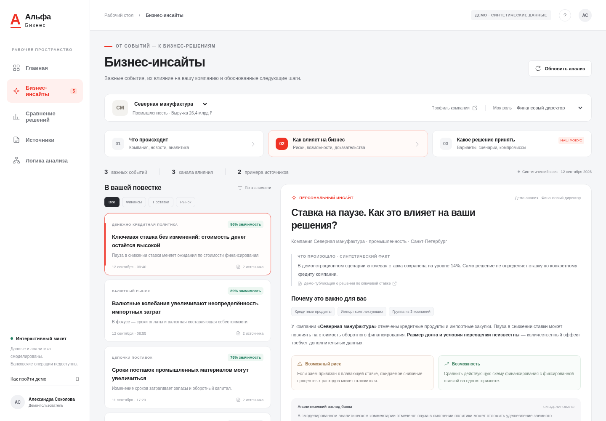

# Interactive UI mockup

A clickable Russian-language mockup of the three-layer product. It uses plain HTML, CSS and JavaScript, with no runtime package installation, external assets, API keys or model calls. All companies, people, news, research snippets, offers and initial numerical inputs are fictional.

## Open or run

Download [alfacase-mockup.zip](alfacase-mockup.zip), extract it, and open its `index.html` in a normal browser tab. The archive includes the complete self-contained page and a short README. No server, install or Internet connection is needed by the mockup itself.

Do not use a chat visualization or source-code/file preview as the browser: it can strip styles, block scripts and show an unstyled shell or “An error occurred inside the visualization.” GitHub also displays HTML source rather than hosting the app. The [standalone HTML](standalone.html) remains available as a download for direct local opening.

This image shows the actual rendered page, without relying on HTML visualization support:



For development, run this command from the repository root:

```sh
python -m http.server 8080 --directory mockup
```

Open the server's root page in a browser. The entry file is [index.html](index.html). No frontend build is necessary. The server only serves static files; it does not implement the proposed FastAPI backend. Stop it with Ctrl+C.

After changing the source files, rebuild the self-contained review artifact:

```sh
python mockup/export.py
```

The editable sources are `index.html`, `styles.css`, `data.js`, and `app.js`. The export command rebuilds both `standalone.html` and the deterministic browser ZIP. Do not hand-edit those generated files.

## Five-minute walkthrough

1. **Bank-home entry:** click «Главная», then «Открыть бизнес-инсайты». The insights entry is also always available in the sidebar.
2. **Personalization:** start with «Северная мануфактура», then select «Вектор Индустрия». Both are industrial companies, with different synthetic financial exposures. The ranking and selected event change. Switch the role to treasury and inspect the changed priorities.
3. **Intelligence and impact:** try the three layer buttons, category filters and event cards. The detail view separates a synthetic event, company context, risks/opportunities and a simulated bank commentary. Unknown loan terms remain unknown.
4. **Sources and agent logic:** open «Источники и доказательства» and «Как работает анализ». Inspect the explanatory diagram, the shared workflow and the missing-evidence branch. «Воспроизвести демо-прогон» animates a simulated trace, without calling any model or search service.
5. **Decision comparison:** on the rate event click «Сравнить варианты». With the default inputs, fixed borrowing reduces the worst cost among the three tested scenarios. Change the objective to minimum cost at the unchanged rate: floating becomes preferable. Set the maximum fee to zero: switching no longer satisfies the constraint. Edit the amount, rates or horizon and inspect the recalculated table and break-even rate.
6. **Follow-up and feedback:** ask a question or select a suggestion. The answer is a labeled context-aware template, not an LLM response. Mark usefulness. Optionally add a new text through «Добавить демо-новость»; classification is a simple keyword rule and its source remains unverified.

All edits, imports, feedback and answers live in memory in this browser tab. They are cleared on reload. Scenario inputs are kept separately per company while the tab remains open. Role selection and company switching are UI demonstrations, not authentication or server-side authorization.

## What works and what is simulated

| Working interaction | Boundary |
|---|---|
| Four company profiles, two roles, category filters, ranked cards and changing context | Synthetic scores and rules; not a validated relevance model |
| Evidence drawer and an inspectable agent workflow | Source passages and tool trace are examples; no actual bank research or live agent |
| Simulated self-check/retry branch and replay animation | No autonomous evidence search, actual model verification or token accounting |
| Two financing options, three scenarios, editable objective/fee constraint, break-even and conditional recommendation | JavaScript arithmetic over explicit synthetic/user inputs; the real implementation will use Python Decimal and the same documented assumptions |
| Follow-up questions and feedback | Template responses and in-tab state; no LLM or persistent storage |
| Manual news-text input and safe text rendering | Keyword-based demo classification; no URL fetch, RSS ingestion, semantic retrieval or authenticity check |
| Responsive layout and keyboard-accessible drawers | Prototype UI, not a production bank integration |

No figures from the calculator are attributed to a model or bank. Its assumptions are visible in «Допущения и формулы»: simple interest, ACT/365, constant principal, immediate full-horizon repricing, and one upfront fee. It does not model amortization, taxes, discounting, other charges or scenario probabilities.

## Agent diagrams

The in-app «Как работает анализ» drawer explains the intended control flow and stopping rules. [AGENT_LOGIC.md](../docs/AGENT_LOGIC.md) contains complementary Mermaid diagrams and a mapping from the simulated UI to future Python functions. Keep both explanations aligned when implementing the real agent.

## Screenshots and validation

- [Overview](screenshots/overview.png)
- [Decision comparison](screenshots/decision.png)
- [Agent logic](screenshots/agent-logic.png)
- [Mobile overview](screenshots/mobile.png)

Browser-validation results are recorded in [VALIDATION.md](VALIDATION.md). They validate the mockup's interaction and arithmetic, not backend readiness, real-source quality or approved-model execution.
